# 🚀 Team PM App — 풀스택 프로젝트 관리 플랫폼 포트폴리오

> **2~10인 원격 팀을 위한 고성능·실시간 올인원 협업 플랫폼**  
> 실시간 웹소켓 분산 동기화(~0.3s) · 부동소수점 칸반 O(1) 이동 · 타임라인 간트 차트 · PostgreSQL 트랜잭션 동시성 제어 · E2E 89단계 무결성 검증

---

## 📌 1. 프로젝트 개요 (Overview)

| 항목 | 상세 내용 |
|---|---|
| **프로젝트명** | Team PM App (원격 팀 협업 & 프로젝트 관리 도구) |
| **운영 상태** | 프로덕션 배포 완료 (M0 ~ M44 전 마일스톤 구현 및 검증 완료) |
| **라이브 데모** | 🔗 [https://team-pm-app-sand.vercel.app](https://team-pm-app-sand.vercel.app) |
| **인터랙티브 웹 포트폴리오** | 🔗 [index.html](index.html) *(브라우저에서 직접 열기 가능)* |
| **담당 역할 및 기여도** | **1인 기여도 100%** (기획, DB 설계, 백엔드/프론트엔드 전체 구현, 보안 점검, 테스트 자동화, 프로덕션 배포 및 운영) |
| **주요 스택** | React 19 (Vite), Node.js (Express), PostgreSQL (Supabase Pooler), Socket.io (Redis Adapter), Vercel |

---

## 📊 2. 핵심 정량적 성과 (Key Metrics)

```
┌─────────────────┐   ┌─────────────────┐   ┌─────────────────┐   ┌─────────────────┐
│     538+ 개     │   │     359 항목    │   │     89 단계     │   │      ~0.3초     │
│ 서버 단위/통합  │   │ 실제 DB 트랜잭션│   │ 브라우저 전체   │   │ 실시간 변경     │
│   테스트 검증   │   │   스모크 통과   │   │ E2E 자동화 통과 │   │ 동기화 반영 속도│
└─────────────────┘   └─────────────────┘   └─────────────────┘   └─────────────────┘
┌─────────────────┐   ┌─────────────────┐   ┌─────────────────┐   ┌─────────────────┐
│     -42.6%      │   │     CVE 0건     │   │      100%       │   │    1인 1표 보장 │
│ 초기 번들 절감  │   │ Strict RLS 격리 │   │ 다크/라이트 테마│   │ FOR UPDATE 락   │
│ (594KB→341KB)   │   │ npm audit 무결점│   │ 모바일 375px 대응│   │ 동시성 무결점   │
└─────────────────┘   └─────────────────┘   └─────────────────┘   └─────────────────┘
```

- **실시간 반응성:** 분산 환경에서 REST 단일 쓰기 경로 + Redis Pub/Sub을 결합하여 평균 **0.31~0.33초** 만에 다른 브라우저 화면에 실시간 동기화.
- **철저한 테스트 주도 검증:** 538개의 API/비즈니스 로직 단위 테스트, 359개 항목의 실제 PostgreSQL DB 스모크 테스트, Playwright 기반 89단계 브라우저 E2E 전 시나리오 연속 통과.
- **웹 성능 최적화:** `lazyPage` 라우트 스플리팅을 통해 첫 진입 번들 크기 **42.6% 절감**(594KB → 341KB, gzip 108KB) 및 청크 404 자동 새로고침 복구 로직 구현.
- **엔터프라이즈급 보안:** Row Level Security(RLS) 기본 차단, Refresh Token 회전(Rotation) 및 재사용 감지(Reuse Detection) 시 전 세션 파기.

---

## 🖼️ 3. 핵심 기능 및 화면 스크린샷 (Feature Showcase)

### 3.1. 칸반 보드 (Kanban Board) & 드래그 앤 드롭
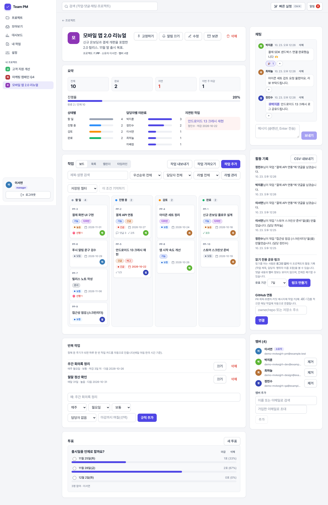
> **다크 모드 뷰:** [dark-04-board.png](portfolio/images/dark-04-board.png)

- **핵심 특징:**
  - HTML5 Drag and Drop API를 활용한 직관적인 작업 카드 이동 (`Todo` ➔ `In Progress` ➔ `Review` ➔ `Done`).
  - **Double-Precision `position` 알고리즘:** 카드를 끼워 넣을 때 단 하나의 행만 UPDATE(O(1))하여 대규모 협업 시에도 DB 락 경합 없이 매끄럽게 동작.
  - Redis WebSocket 브로드캐스트로 접속 중인 다른 팀원들의 화면에 즉시(약 0.3초) 카드가 이동되는 실시간 UI 반영.

---

### 3.2. 작업 상세 모달 (Task Modal) & 마이크로 기능 통합
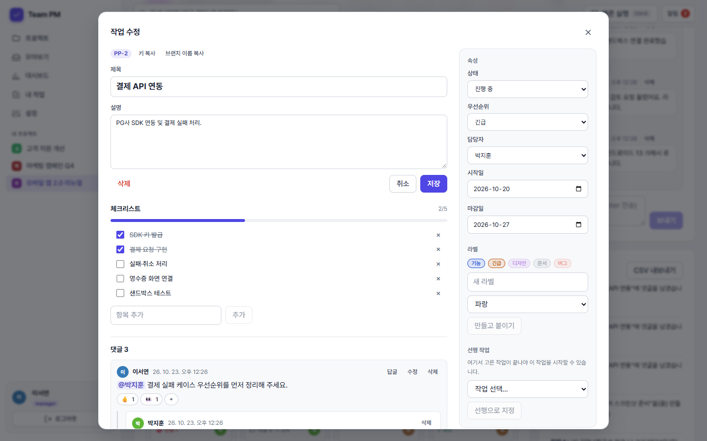

- **핵심 특징:**
  - **체크리스트(서브태스크):** 작업별 최대 50개의 체크리스트 항목 생성 및 카드에 달성률(`✓ done/total`) 즉시 집계.
  - **8색 라벨 시스템:** 프로젝트 공용 라벨(20개 제한) 태깅 및 라벨별 필터링.
  - **스레드 댓글 & 멘션:** 1단계 답글 스레드, `@이름` 멤버 자동완성 및 즉시 멘션 알림, 8종 이모지 리액션(👍❤️😄🎉😮🙏👀✅) 실시간 반응.
  - **소프트 의존성 관리:** 선행 작업 10개 지정 및 재귀 쿼리 기반 순환 의존성(Cycle) 차단.

---

### 3.3. 다채로운 작업 뷰: 리스트 · 캘린더 · 타임라인(간트)

| 뷰 타입 | 주요 기능 및 화면 |
|---|---|
| **일괄 작업 리스트** | 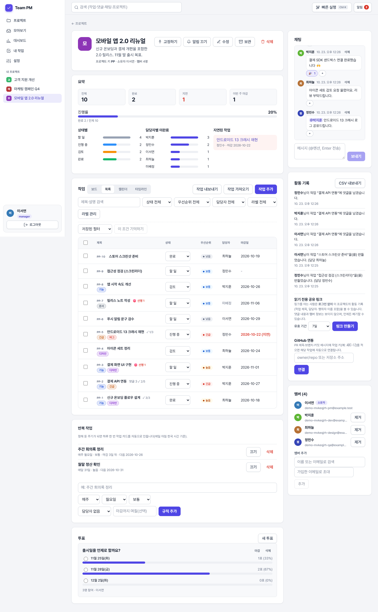<br>최대 50개 작업 일괄 선택(Bulk Selection), 상태/우선순위/담당자/마감일 일괄 변경, 원자적 일괄 삭제, CSV 대량 Import/Export. |
| **월간 캘린더** | 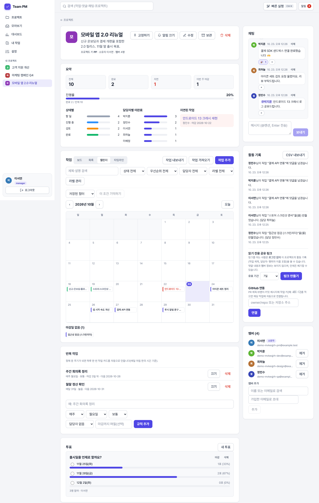<br>마감일 기준 월별 캘린더, 마감일 미지정 카드 서랍, 달 이동 네비게이션, 저장된 필터(Saved Filters) 연동. |
| **타임라인 (간트 차트)** | 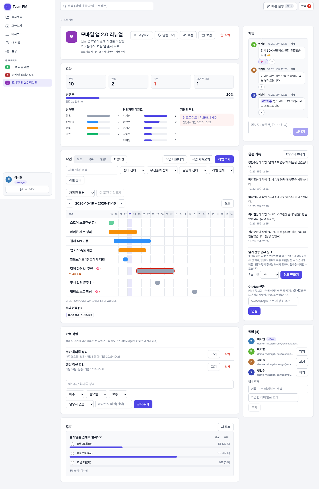<br>시작일~마감일 4주 단위 타임라인 바, 오늘 기준선 표시, 작업 간 일정 충돌 경고 및 선행 의존성 배지 표시. |

---

### 3.4. 실시간 알림 센터 & 대시보드 & 모아보기 피드

| 화면 | 설명 |
|---|---|
| 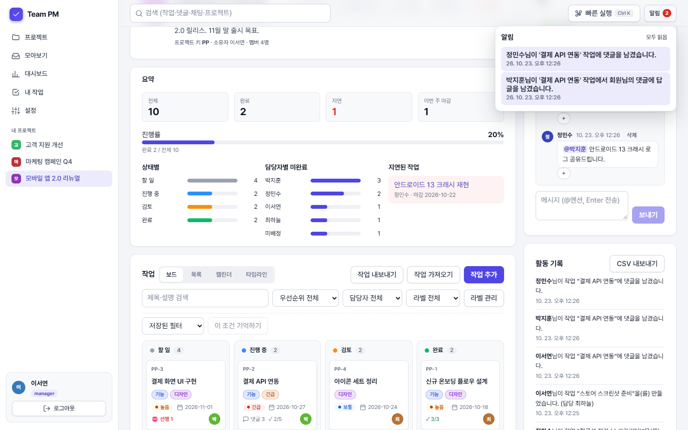 | **실시간 알림 센터**<br>작업 배정, 댓글 답글, @멘션 발생 시 WebSocket 즉시 푸시 & 미확인 배지 카운트. Vercel 일일 Cron 스캔 기반 마감 임박/지연 자동 알림. |
| 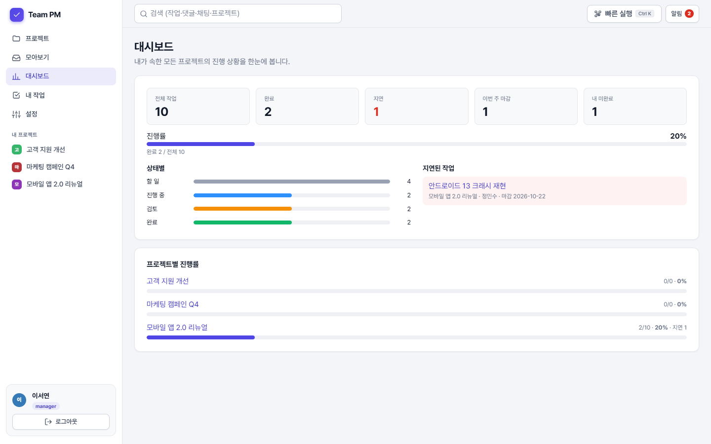 | **프로젝트 대시보드**<br>실시간 집계 쿼리를 통한 프로젝트 진행률, 상태별 분포(원형/막대), 지연된 작업 수, 팀원별 담당 업무 부하 시각화. |
| 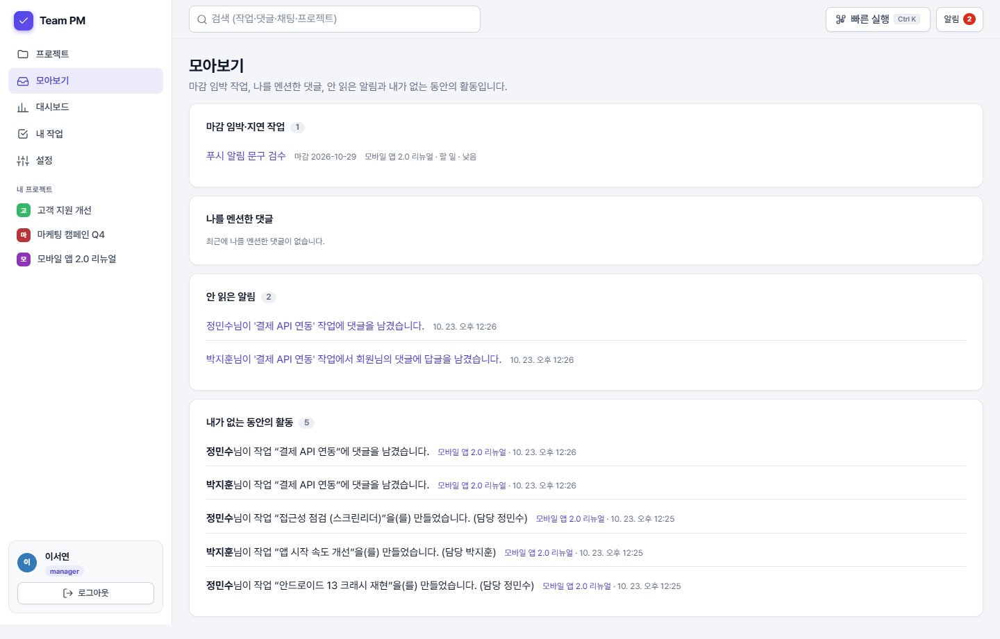 | **개인화 모아보기 (/feed)**<br>7일 이내 지연/임박 작업, 나를 멘션한 댓글, 내가 자리를 비운 동안 일어난 프로젝트 전체 활동 타임라인을 단일 피드로 요약. |

---

### 3.5. 생산성 도구: Ctrl+K 명령 팔레트 & 전역 검색 & 모바일

| 화면 | 설명 |
|---|---|
| 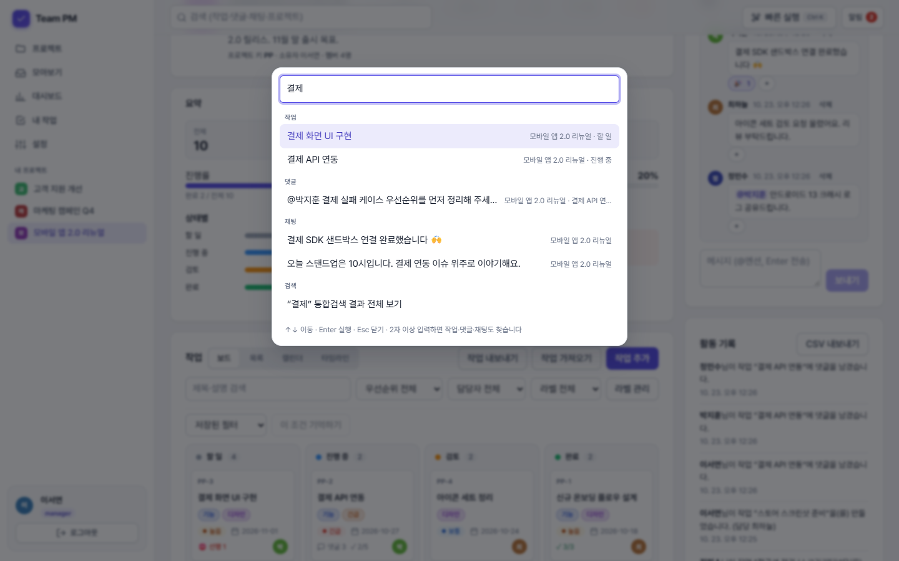 | **Ctrl+K 단축키 명령 팔레트**<br>WAI-ARIA Combobox 접근성 준수, 한글 IME 조합 처리, 키보드 화살표 이동으로 빠른 뷰 전환, 작업 생성, 프로젝트 바로가기. |
| 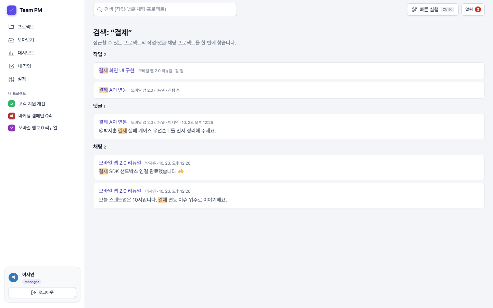 | **전역 통합 검색 (/search)**<br>PostgreSQL `pg_trgm` GIN 인덱스를 적용하여 프로젝트, 작업명/설명, 댓글, 채팅을 한 번에 검색하고 일치 스니펫 하이라이팅 제공. |
| 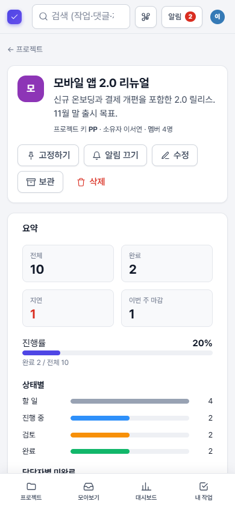 | **완벽한 모바일 반응형 UX**<br>375px 모바일 뷰포트 E2E 검증, 상단 모바일 네비게이션 & 하단 탭 바, 가로 스와이프 칸반 보드 및 모달 전체화면 최적화. |

---

## 🏛️ 4. 시스템 아키텍처 (System Architecture)

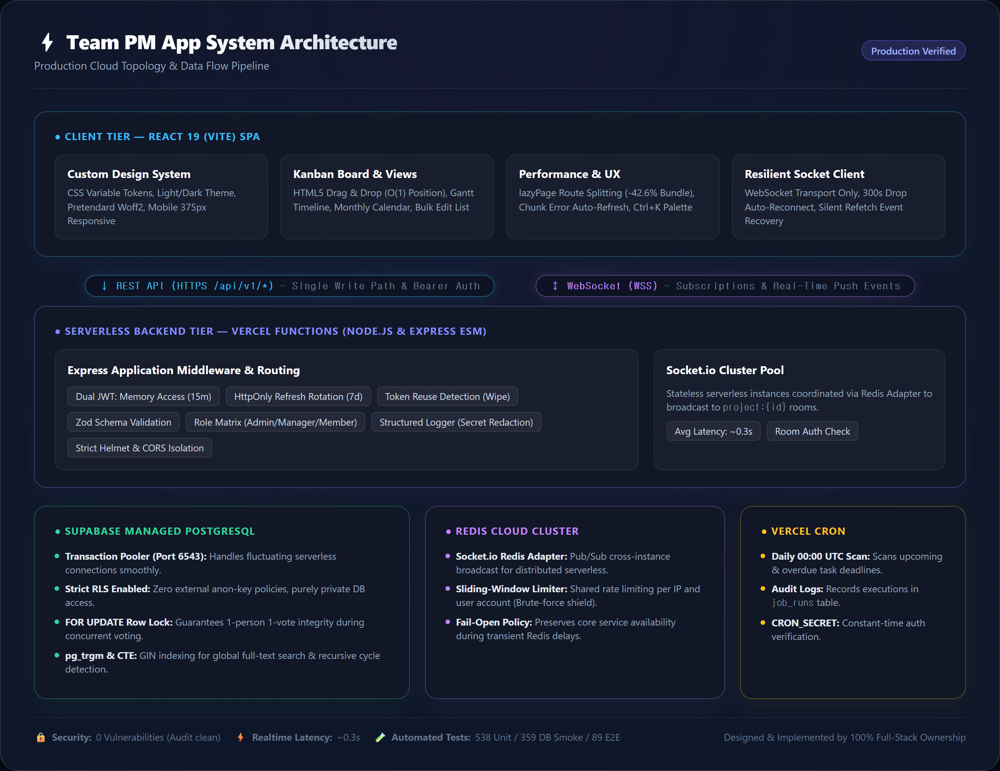
> **고해상도 다이어그램 원본:** [portfolio/images/architecture.png](portfolio/images/architecture.png)

### 4.1. 기술 스택 선정 이유

- **React 19 + Vite:** SPA 환경에서 빠른 HMR 개발 속도와 빌드 최적화 제공. 디자인 시스템 토큰 기반 CSS를 구축하여 외부 UI 라이브러리 없이 가볍고 정밀한 렌더링 달성.
- **Express + Node.js (ESM):** Vercel Serverless 단일 프로젝트로 프론트엔드와 동일 오리진(`Same-Origin`) 배포. 복잡한 CORS 이슈를 제거하고 `HttpOnly; SameSite=Strict` 쿠키의 보안 이점 극대화.
- **Supabase (PostgreSQL 15):** Supabase의 내장 기능(Auth/Realtime)에 종속되지 않고 순수 PostgreSQL로만 운용. **Transaction Pooler (Port 6543)**를 통해 서버리스 인스턴스 급증 시에도 안정적인 커넥션 풀 유지.
- **Socket.io + Redis Adapter:** Vercel 함수는 영구 실행 프로세스가 아니므로 인스턴스 간 메모리 공유가 불가능함. Socket.io Redis 어댑터를 연동하여 REST 쓰기 인스턴스와 소켓 보유 인스턴스 간 분산 브로드캐스트 구축.

---

## 💡 5. 기술적 챌린지 & 트러블슈팅 (Engineering Deep Dive)

### 📌 Case 1. 칸반 보드 카드 재정렬: 부동소수점 포지션(O(1)) 및 정밀도 고갈 방지
- **문제점:** 전통적인 정수 순서(`order_index`) 방식은 중간에 카드를 삽입할 때 뒤에 위치한 모든 카드의 번호를 갱신해야 하므로 **O(N) UPDATE**가 발생함. 여러 팀원이 동시에 카드를 이동하면 락 경합 및 데드락이 빈번해짐.
- **해결책:**
  - `DOUBLE PRECISION` 타입의 `position` 컬럼 도입.
  - 카드를 앞뒤 카드 사이에 드래그할 경우 `(before.position + after.position) / 2.0`으로 **단 1개 행만 UPDATE (O(1))**.
  - **정밀도 고갈 방지:** 동일 위치에서 반복적인 드래그로 두 카드 간 `diff < 1e-9` 수준으로 좁혀지면, 백그라운드에서 해당 컬럼의 모든 카드를 `1024.0, 2048.0, 3072.0...` 간격으로 비동기 재배치(Rebalancing)하여 정밀도 결함을 사전에 예방.

---

### 📌 Case 2. 서버리스 WebSocket 타임아웃(300s) 대응 및 누락 이벤트 자동 복구
- **문제점:** Vercel Hobby 플랜은 서버리스 함수 실행 시간이 최대 300초로 제한되어 소켓 연결이 약 5분마다 강제 종료됨. 단선된 동안 타 사용자가 생성/수정한 작업이 클라이언트 화면에서 누락되는 현상 발생.
- **해결책:**
  - 클라이언트 소켓 연결 시 `transports: ['websocket']` 전용으로 설정하여 폴링 오버헤드 제거.
  - 끊김 발생 시 지수 백오프 기반 즉각 재연결(Auto-Reconnect) 트리거.
  - **Silent Refetch 패턴 구축:** 소켓 재연결 성공 시 현재 보고 있는 프로젝트/작업 데이터를 백그라운드에서 다시 조회하여 단선 시간 동안 발생한 변경 사항을 완벽 복구하도록 구현. E2E 테스트에서 서버 연결 강제 종료 후 생성된 작업이 재연결 시 화면에 즉시 동기화됨을 자동 검증.

---

### 📌 Case 3. PostgreSQL `FOR UPDATE` 트랜잭션 락 기반 익명 1인 1표 보장
- **문제점:** 투표 기능에서 여러 사용자가 동시에 광클하거나 다중 탭에서 동일 계정으로 접근할 경우, `SELECT` 후 `INSERT` 사이에 경쟁 상태(Race Condition)가 발생하여 한 사용자가 여러 선택지에 중복 투표하는 무결성 훼손 위험.
- **해결책:**
  - 트랜잭션 시작 직후 투표 마스터 레코드를 `SELECT ... FOR UPDATE`로 행 수준 배타적 잠금(Lock)을 획득.
  - 잠금 범위 내에서 마감 여부를 재확인하고, "기존 투표 삭제 ➔ 신규 선택지 삽입"을 원자적으로 수행.
  - 데이터베이스 복합 외래키 제약조건(`poll_id, option_id`)을 걸어 다른 투표의 선택지를 찍는 요청을 DB 레벨에서 원천 차단.

---

### 📌 Case 4. Route-based Lazy Loading 및 청크 로딩 실패 1회 자동 새로고침
- **문제점:** 단일 번들 용량이 594KB까지 커져 모바일 환경 초기 접속 속도가 저하됨. 또한 서비스 운영 중 새 버전이 배포되면 이전 해시명의 청크 파일이 CDN에서 삭제되어 사용자가 페이지 이동 시 `ChunkLoadError`를 겪게 됨.
- **해결책:**
  - 커스텀 `lazyPage()` 고차 컴포넌트(HOC)를 설계하여 페이지 단위 지연 로딩 적용 ➔ 초기 번들 크기 **594KB ➔ 341KB (gzip 108KB, 42.6% 감소)**.
  - 청크 다운로드 실패를 감지하면 SessionStorage 플래그를 활용해 **1회에 한해 브라우저를 자동 새로고침**하여 최신 에셋을 수신하도록 내결함성(Resilience) 확보. (10초 내 반복 실패 시에만 사용자에게 에러 화면 표시).

---

### 📌 Case 5. 철저한 보안 아키텍처: Strict RLS & Dual Token Rotation
- **문제점:** Supabase의 공개 API가 노출될 경우 DB 직접 유출 위험이 있고, JWT 토큰 탈취 시 세션 하이재킹 위험 존재.
- **해결책:**
  - **Row Level Security (RLS) 전면 적용:** Supabase의 모든 테이블에 RLS를 활성화하고 정책(Policy)을 등록하지 않아 외부의 Anon Key 직접 접근을 100% 차단. 백엔드 서버(Postgres Superuser)만 풀러를 통해 정상 쿼리 수행.
  - **듀얼 토큰 & 회전:** 15분 만료 Access Token은 메모리에만 유지(XSS 면역), 7일 만료 Refresh Token은 `HttpOnly; SameSite=Strict; Secure; Path=/api/v1/auth` 쿠키로 전송하며 DB에는 SHA-256 해시값만 저장.
  - **토큰 재사용 감지(Token Reuse Detection):** 이미 사용되어 회전된 이전 Refresh Token이 들어오면 토큰 탈취 시도로 간주하고 해당 유저의 모든 활성 세션을 즉각 무효화.

---

## 🧪 6. 테스트 자동화 & 품질 보증 (QA & CI/CD)

```
[Layer 1] Unit / Integration Tests (538개)
  └─ In-memory Data Store 기반 컨트롤러, 유효성 검증, 상태 전이 테스트 (0.5초 내 고속 실행)

[Layer 2] Real Database Smoke Tests (359항목)
  └─ 실제 Supabase DB 연결, PostgreSQL 격리 수준, 트랜잭션 롤백, 동시성 잠금 검증

[Layer 3] Browser E2E Tests (89단계)
  └─ Playwright 기반 2개 브라우저 동시 기동, 실시간 웹소켓 전달 검증, 375px 모바일 뷰 검증

[Layer 4] Visual Regression Screen Capture (`npm run screens`)
  └─ 다크/라이트 테마 35개 화면 고해상도 스냅샷 자동 생성 및 정렬 검증
```

---

## 📂 7. 프로젝트 문서 및 아티팩트 안내

- **인터랙티브 웹 포트폴리오:** [portfolio/index.html](portfolio/index.html)
- **설계 및 ERD 명세서:** [docs/DESIGN.md](docs/DESIGN.md)
- **프로젝트 목표 및 완료 기준:** [docs/PROJECT_GOAL.md](docs/PROJECT_GOAL.md)
- **배포 및 운영 가이드:** [docs/DEPLOYMENT.md](docs/DEPLOYMENT.md)
- **보안 점검 리포트:** [docs/SECURITY.md](docs/SECURITY.md)
- **로드맵 및 마일스톤 이력:** [docs/ROADMAP.md](docs/ROADMAP.md)

---

*본 포트폴리오는 실제 배포되어 동작하는 시스템의 아키텍처 설계와 테스트 검증 결과를 기반으로 작성되었습니다.*
